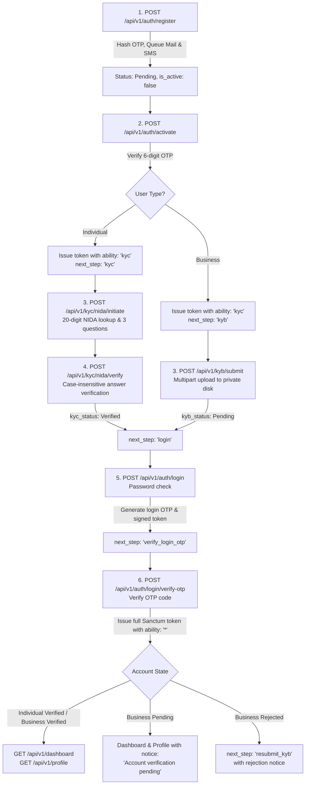

# Airlipa Secure Production REST API

A production-grade, secure REST API developed in **Laravel 11/12** and **PHP 8.2+** using **Laravel Sanctum** token authentication, clean architecture, 2-step OTP verification, NIDA mock identity verification (KYC), business verification (KYB), strict security headers, and automated test coverage.

---

## Architecture & Authentication Lifecycle



---

## Consistent Response Envelope

All API endpoints strictly output the consistent JSON envelope:

```json
{
  "success": true,
  "message": "Operation completed successfully.",
  "data": { ... },
  "errors": null,
  "next_step": "dashboard"
}
```

On validation or authorization errors:

```json
{
  "success": false,
  "message": "Validation failed.",
  "data": null,
  "errors": {
    "email": [
      "The email field must be a valid email address."
    ]
  },
  "next_step": null
}
```

---

## Security Implementation Highlights

1. **Encrypted NIDA with Blind Indexing**:
   - `nida_number` is stored encrypted using Laravel's native `'encrypted'` cast (AES-256-CBC).
   - A SHA-256 blind index hash (`nida_hash`) is indexed uniquely to prevent multiple users from linking the same NIDA number without decrypting all database rows.
2. **Timing-Safe Constant-Time Password Checks**:
   - Generic `"Invalid credentials"` returned for login failures to prevent user enumeration.
   - Fallback dummy bcrypt hash verification prevents side-channel timing leaks when an email does not exist.
3. **Lockout Controls**:
   - **Login**: Account locks for 15 minutes after 5 failed consecutive attempts (`locked_until`).
   - **KYC**: Account locks for 24 hours after 3 failed verification attempts in a 24-hour window.
4. **2-Step Login OTP**:
   - Password authentication does not issue full tokens. It generates a 6-digit numeric OTP and a signed/encrypted 5-minute `otp_session_token`.
   - Full Sanctum tokens (`['*']`, 60-minute expiry) are only issued upon valid OTP verification.
5. **Private Storage & MIME Verification**:
   - Business KYB documents are stored on a private disk (`local`), never exposed to public storage.
   - Strict server-side MIME verification via `finfo` and rejection of double extensions (e.g., `document.php.pdf`).
   - Document downloads require temporary signed URLs (`URL::temporarySignedRoute`) or owner/admin authorization.
6. **Production Security Headers**:
   - `Strict-Transport-Security: max-age=31536000; includeSubDomains`
   - `X-Content-Type-Options: nosniff`
   - `X-Frame-Options: DENY`
   - `Referrer-Policy: strict-origin-when-cross-origin`
   - `Content-Security-Policy: default-src 'none'; frame-ancestors 'none'`
7. **Rate Limiting**:
   - Register: 5 requests / min / IP
   - Login: 5 requests / min / email + IP
   - OTP Verify: 5 requests / min
   - OTP Resend: 60s cooldown and max 3 resends / hour
   - Global API: 60 requests / min

---

## Environment Variables (`.env`)

Add or update the following values in your `.env` file:

```env
APP_NAME=Airlipa
APP_ENV=local
APP_KEY=base64:IBE53rK1ypAsKN20hcH0PdEQRdhlhhM+NKFSWAF692o=
APP_DEBUG=true
APP_URL=http://localhost:8000

# Database
DB_CONNECTION=mysql
DB_HOST=127.0.0.1
DB_PORT=3306
DB_DATABASE=airlipa
DB_USERNAME=root
DB_PASSWORD=

# Session & Cache
SESSION_DRIVER=database
CACHE_STORE=database
QUEUE_CONNECTION=database

# Email
MAIL_MAILER=log
MAIL_FROM_ADDRESS="no-reply@airlipa.com"
MAIL_FROM_NAME="${APP_NAME}"

# SMS Provider Configuration
SMS_DRIVER=log
SMS_URL=https://api.africastalking.com/version1/messaging
SMS_KEY=your_sms_api_key
SMS_SENDER=AIRLIPA

# Authentication & OTP Security Settings
AUTH_OTP_ACTIVATION_LENGTH=6
AUTH_OTP_ACTIVATION_EXPIRY_MINUTES=10
AUTH_OTP_ACTIVATION_MAX_ATTEMPTS=5
AUTH_OTP_ACTIVATION_COOLDOWN_SECONDS=60
AUTH_OTP_ACTIVATION_MAX_RESENDS_PER_HOUR=3

AUTH_OTP_LOGIN_LENGTH=6
AUTH_OTP_LOGIN_EXPIRY_MINUTES=5
AUTH_OTP_LOGIN_MAX_ATTEMPTS=5
AUTH_OTP_LOGIN_COOLDOWN_SECONDS=60
AUTH_OTP_LOGIN_MAX_RESENDS_PER_HOUR=3
AUTH_OTP_LOGIN_SESSION_MINUTES=5

AUTH_LOCKOUT_MAX_FAILED_LOGINS=5
AUTH_LOCKOUT_MINUTES=15

KYC_SESSION_EXPIRY_MINUTES=10
KYC_MAX_FAILED_ATTEMPTS=3
KYC_LOCKOUT_HOURS=24

SANCTUM_KYC_TOKEN_EXPIRY_MINUTES=60
SANCTUM_FULL_TOKEN_EXPIRY_MINUTES=60
```

---

## Setup & Installation

1. **Clone & Install Dependencies**:
   ```bash
   composer install
   ```

2. **Generate Key & Configure Storage**:
   ```bash
   php artisan key:generate
   ```

3. **Run Migrations & Seed Mock NIDA Records**:
   ```bash
   php artisan migrate:fresh --seed
   ```

4. **Start Application Server & Queue Listener**:
   ```bash
   php artisan serve
   php artisan queue:listen
   ```

---

## Seeded Admin Account

- **Email**: `admin@airlipa.com`
- **Password**: `AdminSecure#2026!`
- **Role**: `admin` (Authorized for `PATCH /api/v1/admin/kyb/{id}/approve` and `reject`)

---

## 20 Mock NIDA Records (Test Numbers & Answers)

All 20 records are automatically seeded via `php artisan db:seed` (`NidaMockSeeder`):

| # | NIDA Number | Name | Date of Birth | Mother's Name | Place of Birth | Region | District |
|---|-------------|------|---------------|---------------|----------------|--------|----------|
| 1 | `19900101123450000001` | Juma Hamisi | 1990-01-01 | Fatuma | Dar es Salaam | Dar es Salaam | Ilala |
| 2 | `19920512123450000002` | Asha Bakari | 1992-05-12 | Mariam | Zanzibar | Mjini Magharibi | Mjini |
| 3 | `19881120123450000003` | Baraka Massawe | 1988-11-20 | Grace | Moshi | Kilimanjaro | Moshi Urban |
| 4 | `19950315123450000004` | Neema Mushi | 1995-03-15 | Joyce | Arusha | Arusha | Arusha City |
| 5 | `19850722123450000005` | Kelvin Shirima | 1985-07-22 | Agnes | Rombo | Kilimanjaro | Rombo |
| 6 | `19930908123450000006` | Rehema Kassim | 1993-09-08 | Zubeda | Tanga | Tanga | Tanga City |
| 7 | `19871204123450000007` | Emmanuel Makundi | 1987-12-04 | Esther | Mbeya | Mbeya | Mbeya City |
| 8 | `19940228123450000008` | Zuhura Salum | 1994-02-28 | Halima | Morogoro | Morogoro | Morogoro Urban |
| 9 | `19910617123450000009` | Godfrey Temu | 1991-06-17 | Anna | Hai | Kilimanjaro | Hai |
| 10 | `19961010123450000010` | Upendo Tarimo | 1996-10-10 | Rose | Moshi | Kilimanjaro | Moshi Rural |
| 11 | `19890405123450000011` | Dennis Kimaro | 1989-04-05 | Beatrice | Dodoma | Dodoma | Dodoma Urban |
| 12 | `19970819123450000012` | Farida Ally | 1997-08-19 | Amina | Tabora | Tabora | Tabora Urban |
| 13 | `19860325123450000013` | Innocent Mollel | 1986-03-25 | Sikitu | Monduli | Arusha | Monduli |
| 14 | `19981212123450000014` | Hadija Mwinyi | 1998-12-12 | Saida | Bagamoyo | Pwani | Bagamoyo |
| 15 | `19900930123450000015` | Geoffrey Lyimo | 1990-09-30 | Martha | Mwanza | Mwanza | Nyamagana |
| 16 | `19930707123450000016` | Zainab Rashid | 1993-07-07 | Khadija | Lindi | Lindi | Lindi Urban |
| 17 | `19841024123450000017` | Joseph Mwita | 1984-10-24 | Tabu | Musoma | Mara | Musoma Urban |
| 18 | `19950505123450000018` | Jackline Minja | 1995-05-05 | Flora | Iringa | Iringa | Iringa Urban |
| 19 | `19920118123450000019` | Rashid Athumani | 1992-01-18 | Mwanahamis | Kigoma | Kigoma | Kigoma Ujiji |
| 20 | `19960823123450000020` | Saumu Omari | 1996-08-23 | Bimkubwa | Mtwara | Mtwara | Mtwara Urban |

---

## Postman Collection

Import `postman_collection.json` located at the root of the project into Postman. It includes pre-configured environment variables and full examples for every endpoint.

---

## Service 2: Protected Payment (Conditional Payment Workflow Core)

Service 2 implements the **Airlipa One Protected Payment Core** (excluding e-commerce storefront/catalog/cart) in compliance with the SASDS architecture:

- **Partner-Backed Custody Model**: Funds are collected and held through licensed Tanzanian payment providers/banks (`MPESA_TZ`, `TPESA_TZ`, `MIXX_TZ`, `AIRTEL_TZ`, `TANQR_BOT`, `CRDB_BANK`, `SANDBOX_PSP`) while Airlipa governs the conditional release workflow and append-only double-entry operational sub-ledger.
- **Integer Minor Units Only**: All monetary values, fee quotes, ledger postings, and conservation invariants are calculated and persisted in integer minor units (`100 minor units = 1.00 TZS`) without floating-point arithmetic.
- **Explicit Domain Conservation Invariant**: Every Protected Payment strictly satisfies:
  $$F = P + R_L + R_Q + L + Q + V$$
  and $0 \le D \le P$, where $F$ is funded principal, $P$ is protected balance, $D$ is disputed/frozen balance, $R_L$ is reserved for release, $R_Q$ is reserved for refund, $L$ is released to merchant, $Q$ is refunded to buyer, and $V$ is reversed/voided.
- **Append-Only Double-Entry Sub-Ledger (`M08`)**: Every financial state transition posts balanced debit/credit journals across `1100-PROVIDER-CLEARING`, `2100-PROTECTED-CUSTOMER-FUNDS`, `2200-MERCHANT-PAYABLE`, `2300-REFUND-PAYABLE`, `2400-DEFERRED-PLATFORM-FEE`, `2500-TAX-PAYABLE-VAT`, and `4100-EARNED-PLATFORM-REVENUE`.

### Protected Payment API Endpoints (`/api/v1`)

| Module | Method | Endpoint | Description |
|--------|--------|----------|-------------|
| **M03 Merchant Trust** | `GET` | `/api/v1/merchants/{merchantId}/trust-profile` | Public merchant verification badge, KYB/KYC tier, and track record |
| **M18 Provider Governance** | `GET` | `/api/v1/providers` | List licensed payment provider capabilities (`MPESA_TZ`, `TPESA_TZ`, `MIXX_TZ`, `AIRTEL_TZ`, `TANQR_BOT`, `CRDB_BANK`, `SANDBOX_PSP`) |
| **M18 Provider Governance** | `PATCH` | `/api/v1/admin/providers/{providerCode}/status` | Admin governance endpoint to activate or suspend a rail |
| **M15 Pricing & Quotes** | `GET` | `/api/v1/pricing/schedules/current` | Retrieve effective-dated price book rules |
| **M15 Pricing & Quotes** | `POST` | `/api/v1/pricing/quotes` | Create a deterministic, versioned `FeeQuote` (`15 min` TTL) |
| **M15 Pricing & Quotes** | `GET` | `/api/v1/pricing/quotes/{quoteId}` | Inspect a `FeeQuote` |
| **M15 Pricing & Quotes** | `POST` | `/api/v1/pricing/quotes/{quoteId}/accept` | Accept a `FeeQuote` prior to funding |
| **M06 Checkout Links** | `GET` | `/api/v1/payment-links/{token}` | Public, strictly read-only preview of a Protected Payment Link (`BPA-CH-14`) |
| **M06 Checkout Links** | `POST` | `/api/v1/payment-links` | Create a shareable Protected Payment Link (verified merchants only) |
| **M06 Checkout Links** | `GET` | `/api/v1/payment-links` | List merchant's Protected Payment Links |
| **M06 Checkout Links** | `PATCH` | `/api/v1/payment-links/{linkId}/revoke` | Revoke an active Protected Payment Link |
| **M06 Checkout Links** | `POST` | `/api/v1/payment-links/{token}/checkout` | Buyer accepts link terms & creates a `ProtectedPayment` agreement |
| **M06 Protected Payments** | `POST` | `/api/v1/protected-payments` | Directly create a `ProtectedPayment` agreement (supports milestones) |
| **M06 Protected Payments** | `GET` | `/api/v1/protected-payments` | List buyer/merchant Protected Payment agreements |
| **M06 Protected Payments** | `GET` | `/api/v1/protected-payments/{id}` | Retrieve agreement state, milestones, evidence, disputes, and ledger trail |
| **M05 Orchestration** | `POST` | `/api/v1/protected-payments/{id}/pay` | Initiate an idempotent `PaymentIntent` & `PaymentAttempt` |
| **M05 Orchestration** | `GET` | `/api/v1/protected-payments/{id}/status-recovery` | Re-query non-final (`PENDING`/`UNKNOWN`) payment attempt status |
| **M05 Webhooks** | `POST` | `/api/v1/webhooks/providers/{providerCode}` | Receive HMAC-SHA256 authenticated provider callbacks |
| **M05 Sandbox Helper** | `POST` | `/api/v1/protected-payments/{id}/simulate-provider-callback` | Local/testing helper to sign and dispatch a provider callback (`SUCCEEDED`, `PENDING`, `UNKNOWN`, `FAILED`) |
| **M10 Evidence** | `POST` | `/api/v1/protected-payments/{id}/evidence` | Submit delivery/fulfillment evidence with SHA-256 integrity hash |
| **M06 Release** | `POST` | `/api/v1/protected-payments/{id}/release` | Step-up authenticated (`handover_otp` or `step_up_password`) full or milestone release |
| **M06 Refund** | `POST` | `/api/v1/protected-payments/{id}/refund` | Execute full or partial refund using original `FeeQuote` version |
| **M14 Payouts** | `GET` | `/api/v1/payout-accounts` | List merchant verified payout accounts |
| **M14 Payouts** | `POST` | `/api/v1/payout-accounts` | Register a verified merchant payout account with step-up password (`BPA-DATA-03`) |
| **M14 Payouts** | `POST` | `/api/v1/protected-payments/{id}/settle-payout` | Execute merchant payout settlement for released, undisputed funds |
| **M14 Payouts** | `GET` | `/api/v1/payouts` | List merchant payout instructions & settlement batches |
| **M06 Receipt** | `GET` | `/api/v1/protected-payments/{id}/receipt` | Generate a cryptographically verifiable digital receipt (`FR-023`) |
| **M08 Journals** | `GET` | `/api/v1/protected-payments/{id}/journals` | Retrieve balanced double-entry sub-ledger journals for an agreement |
| **M11 Disputes** | `POST` | `/api/v1/protected-payments/{id}/disputes` | Open a dispute (`NON_DELIVERY`, `MATERIALLY_DIFFERENT`, `PARTIAL_DELIVERY`, etc.) and atomically freeze funds |
| **M11 Disputes** | `GET` | `/api/v1/disputes/{caseId}` | View dispute case details |
| **M11 Disputes** | `POST` | `/api/v1/admin/disputes/{caseId}/resolve` | Admin dispute resolution (`FULL_RELEASE_MERCHANT`, `FULL_REFUND_BUYER`, `PARTIAL_SPLIT`) |
| **M08 Sub-Ledger** | `GET` | `/api/v1/ledger/obligations-summary` | Real-time customer-funds obligation vs. provider clearing balance |
| **M12 Notifications** | `GET` | `/api/v1/notifications` | Bilingual (`?lang=en` / `?lang=sw`) user notifications via Transactional Outbox |
| **M12 Notifications** | `PATCH` | `/api/v1/notifications/{notificationId}/read` | Mark notification as read |
| **M13 Support Cases** | `POST` | `/api/v1/support/tickets` | Open customer support case linked to a transaction or dispute |
| **M13 Support Cases** | `GET` | `/api/v1/support/tickets` | List user/admin support cases |
| **M13 Support Cases** | `POST` | `/api/v1/support/tickets/{ticketNumber}/messages` | Reply to a support ticket |
| **M16 Reporting** | `GET` | `/api/v1/reports/statements` | User/merchant statement with fee, VAT, and net settlement breakdown |
| **M16 Reporting** | `GET` | `/api/v1/admin/reports/trial-balance` | Complete operational sub-ledger trial balance |
| **M16 Reporting** | `GET` | `/api/v1/admin/reports/safeguarding-proof-pack` | Regulatory safeguarding & conservation invariant proof pack |
| **M09 Reconciliation** | `POST` | `/api/v1/admin/reconciliation/runs` | Execute 3-way reconciliation run (Statement vs Orchestration vs Sub-Ledger) |
| **M09 Reconciliation** | `GET` | `/api/v1/admin/reconciliation/exceptions` | List open/resolved reconciliation exceptions |
| **M09 Reconciliation** | `PATCH` | `/api/v1/admin/reconciliation/exceptions/{exceptionId}/resolve` | Resolve a reconciliation exception with audit trail |
| **M07 Risk Engine** | `GET` | `/api/v1/admin/risk/alerts` | List velocity, high-value, and anomaly risk alerts |
| **M07 Risk Engine** | `PATCH` | `/api/v1/admin/risk/alerts/{alertCode}/review` | Compliance review of a risk alert |
| **M17 Dual Control** | `POST` | `/api/v1/admin/governance/approvals` | Maker initiates a dual-control governance request (`P-05`, `FR-036`) |
| **M17 Dual Control** | `POST` | `/api/v1/admin/governance/approvals/{approvalCode}/decide` | Independent checker approves/rejects dual-control request (`Maker != Checker`) |
| **M17 Audit Chain** | `GET` | `/api/v1/admin/audit-logs/verify-chain` | Verify tamper-evident SHA-256 hash chain across all audit logs (`FR-030`) |

---

## Service 3: Escrow Contracts (Two-Party Agreement Layer, Phase 1)

Service 3 adds the full two-party escrow contract lifecycle on top of the Protected Payment core. The initiator (buyer **or** seller) drafts a contract, shares it over every channel, and the counterparty accepts it with an OTP-backed e-signature. Acceptance mints the underlying `ProtectedPayment` (Figure 5 state machine) and opens the subledger set atomically.

- **Lifecycle**: `DRAFT -> SHARED -> ACCEPTED` with `REJECTED`, `EXPIRED` (hourly `escrow-contracts:expire-overdue` job) and `CANCELLED` branches. Server-side enforcement only; every transition is audit-logged.
- **Sharing channels**: WhatsApp (`wa.me` deep link), SMS (gateway driver), Email (HTML template + link), QR (scannable payload), and copyable secure link. Each share carries a **signed, expiring, single-contract HMAC token** (`{contractId}.{expiry}.{hmac}`); views are tracked per channel (`CREATED/DELIVERED/OPENED`, `view_count`, `opened_at`).
- **Acceptance & e-signature**: counterparty may view anonymously but must register + verify by OTP (`contract_acceptance` purpose). The signature row stores name, phone, IP, device, SHA-256 `contract_hash` of the canonical final terms and the OTP verification timestamp. Contracts are immutable after acceptance.
- **Counter-proposals**: `request-changes` creates version *n+1* (`PENDING_INITIATOR_APPROVAL`); the initiator's approval makes it `CURRENT`, supersedes older versions and re-opens the acceptance window. Stale-version links cannot be accepted.
- **Subledger foundation** (Phase 1 of the ledger programme): `contract_subledger_accounts` (Deposited / Available / Held-for-Milestones / Frozen / Pending-Release / Pending-Refund / Released / Refunded / Fees buckets), `milestone_subledger_accounts`, `party_subledger_accounts`, `dispute_holds`, `fee_records`, append-only `subledger_entries`, `balance_snapshots` (daily close via `ledger:snapshot-subledgers`) and `suspense_items`.
- **Invariants**: money conservation (`deposited == available + held + frozen + pending_release + pending_refund + released + refunded`), row-locked bucket transfers, operation-level idempotency keys (replayed webhooks never move funds twice), overspend rejection, and portfolio scans consumed by reconciliation. Deposit/release/refund/dispute postings wire into these buckets in Phases 2-4.

### Escrow Contract API Endpoints (`/api/v1`)

| Module | Method | Endpoint | Description |
|--------|--------|----------|-------------|
| M1 Contracts | `POST` | `/api/v1/contracts` | Create a DRAFT escrow contract (roles, milestones, terms, fee payer) |
| M1 Contracts | `GET` | `/api/v1/contracts` | List contracts I initiated or was invited to |
| M1 Contracts | `GET` | `/api/v1/contracts/{id}` | Contract detail with versions, signatures and subledger (parties only) |
| M1 Contracts | `PATCH` | `/api/v1/contracts/{id}` | Edit while DRAFT (refreshes terms hash) |
| M2 Sharing | `POST` | `/api/v1/contracts/{id}/share` | Share via `WHATSAPP,SMS,EMAIL,QR,LINK`; initiator e-signs; returns tokens/payloads |
| M2 Sharing | `GET` | `/api/v1/contracts/share/{token}` | Public read-only view via signed token; tracks opened/viewed |
| M3 Acceptance | `POST` | `/api/v1/contracts/share/{token}/acceptance-otp` | Issue acceptance OTP to the named counterparty |
| M3 Acceptance | `POST` | `/api/v1/contracts/share/{token}/accept` | OTP + e-signature acceptance; mints Protected Payment & opens subledgers |
| M3 Acceptance | `POST` | `/api/v1/contracts/share/{token}/reject` | Reject with reason |
| M3 Versioning | `POST` | `/api/v1/contracts/share/{token}/request-changes` | Counter-proposal (new version pending initiator approval) |
| M3 Versioning | `POST` | `/api/v1/contracts/{id}/versions/{version}/approve` | Initiator approves a counter-proposal |
| M1 Contracts | `POST` | `/api/v1/contracts/{id}/cancel` | Cancel while DRAFT/SHARED |

### Spec vs. design-pack reconciliation

The product brief's textual state machine (`DRAFT -> SHARED -> ACCEPTED -> AWAITING_DEPOSIT -> FUNDED -> ...`) and the design pack figures (Figure 5: `DRAFT -> PAYMENT_PENDING -> FUNDED_PROTECTED -> FULFILMENT_IN_PROGRESS -> AWAITING_ACCEPTANCE -> ...`) describe the same money flow at two altitudes. Per the working instructions the figures are authoritative: the **contract layer** owns `DRAFT/SHARED/ACCEPTED/...` (agreement between parties) and hands off to the **Protected Payment state machine** (Figure 5) for custody, fulfilment, dispute-freeze and settlement. `AWAITING_ACCEPTANCE` in Figure 5 remains the buyer's *delivery* acceptance, distinct from contract acceptance in Module 3.

---

## Service 4: Selcom Deposits & Dynamic QR (Phase 2)

Phase 2 wires the deposit side of the escrow platform to **Selcom as the single licensed payment partner**: one pooled escrow account, all rails (Airtel Money, M-Pesa, Tigo Pesa/Mixx by Yas, Halopesa, Selcom Pay, bank transfer, Airtel Lipa, TanQR) collected through it.

- **SelcomProvider** (`app/Services/PaymentProviders/SelcomProvider.php`) implements the provider-neutral `PaymentProviderAdapterInterface` (initiateCollection / queryStatus / executeRelease / executeRefund / webhook sign+verify). Sandbox mode is a deterministic in-process mock; live mode talks HTTP with idempotency keys and safe-fails to `UNKNOWN` on gateway errors.
- **Posting-rules engine** (`app/Services/Ledger/PostingRulesEngine.php`): every business event maps to versioned, balanced journal lines - `DEPOSIT_CONFIRMED`, `DEPOSIT_OVERPAYMENT_SUSPENSE`, `DEPOSIT_PARTIAL_HELD` live now; release/refund/dispute/fee-sweep rules register here in later phases. Catalogue exposed at `GET /api/v1/ledger/posting-rules`. No ad-hoc postings.
- **Deposit postings**: a verified Selcom confirmation posts the GL funding journal AND, in the same transaction, credits the contract subledger (Deposited/Available), earmarks milestone contracts into `held_milestones`, funds each milestone sub-account, and raises buyer `funded` / seller `entitled` party positions - all append-only and idempotent per funding journal.
- **Overpayments** fund only the payable total; the excess is journaled to `1300-SUSPENSE-UNRECONCILED`, recorded as an UNMATCHED suspense item with a HIGH reconciliation exception for refund/matcher approval. **Part payments** never fund: they are held in suspense with bilingual buyer notification.
- **Dynamic deposit QR** (`GET /api/v1/protected-payments/{id}/deposit-qr`, `GET /api/v1/contracts/{id}/deposit-qr`): TanQR/EMVCo TLV payload with the exact amount, contract reference and pooled-account Lipa Namba, CRC16-CCITT checksummed; scannable from any wallet or bank app.
- Instant bilingual (EN/SW) outbox notifications to both parties on confirmed deposits.

---

## Service 5: Release, Payouts & Delivery Handshake (Phase 3)

Phase 3 completes the outbound side of escrow: money can only leave the pooled Selcom account on a verified, authorised chain of events.

- **Reserve before you pay**: `RELEASE_REQUESTED` moves contract `available -> pending_release` and, for the seller, `entitled -> held` *before* the provider call. If Selcom rejects the disbursement the reservation is reversed and the funds return to `available`; a release can never be spent twice while in flight.
- **Provider-confirmed release**: on success the contract and milestone subledgers move `pending_release -> released`, then `LedgerService::postProtectedRelease` posts the balanced GL journal with proportional merchant fee/VAT and deferred buyer-fee recognition.
- **Payout controls** (`POST /api/v1/protected-payments/{id}/settle-payout`): destination account name must match the merchant's KYC/KYB name (AML), high-value payouts require step-up (`step_up_password` or `handover_otp`), and payouts at/above the dual-control threshold require a prior independent `LARGE_PAYOUT` maker-checker approval (creator != approver). Settlement moves the seller position `held -> paid_out`.
- **Retry with backoff**: a provider rejection records a `PENDING` instruction with `retry_count`/`next_retry_at` and dispatches `RetryFailedPayoutJob` (1min, 5min, 25min), reusing the same idempotency key so one provider effect maps to one journal effect. After the final attempt the instruction is `BLOCKED` and escalated to Finance, with the merchant told the funds remain safe in escrow.
- **QR delivery handshake**: sellers issue a single-use, expiring delivery code (`POST /protected-payments/{id}/delivery-qr`); only the buyer can consume it (`POST /protected-payments/{id}/confirm-delivery`), which flips fulfilment to `DELIVERED_CONFIRMED` and the agreement to `AWAITING_ACCEPTANCE`. Replays and expired codes are refused.

---

## Service 6: Disputes, Appeals & Refunds (Phase 4)

- **Freeze is real**: opening a dispute posts the `DISPUTE_FREEZE` GL journal *and* moves the disputed amount `available -> frozen` in the contract subledger, records a `dispute_holds` row, and blocks payout settlement (409) until resolved.
- **Timeline + chat**: every case carries an append-only chronological record - system events (`TIMELINE`), party/admin chat (`MESSAGE`, optional staff-only `internal` notes), decisions (`DECISION`) and appeals (`APPEAL`). Endpoints: `GET /disputes/{caseId}/timeline`, `POST /disputes/{caseId}/messages`.
- **Mediator decisions** (`POST /admin/disputes/{caseId}/resolve`): `FULL_REFUND_BUYER`, `FULL_RELEASE_MERCHANT` or a `PARTIAL_SPLIT` whose legs must sum to the frozen amount. Execution settles the hold `frozen -> released / refunded` and keeps full conservation; segregation of duties is enforced (no party, no case opener, no self-review).
- **One appeal** (`POST /disputes/{caseId}/appeal`): only parties, only inside the configured window, only once. An appealed case is locked against further financial decisions; an independent reviewer (`POST /admin/disputes/{caseId}/appeal-decision`) upholds (`CLOSED`) or escalates (`UNDER_REVIEW`). Money already paid out is never silently rewritten - changes require reversal postings.
- **Refunds** (`POST /protected-payments/{id}/refunds`, `GET .../refunds`): full, partial or milestone-scoped, defaulting to the buyer's original Selcom method. Reserved `available -> pending_refund` before the provider call, then `pending_refund -> refunded` with the buyer's party position moving `funded -> refunded` and the seller's entitlement reduced. Provider rejection reverses the reservation (reversal-only, no edits). Each refund is tracked as a `RefundRequest` with its own idempotency key.
- **PDF case file** (`GET /disputes/{caseId}/case-file`): dependency-free PDF 1.4 dossier (parties, amounts, decision, appeal state, full timeline) with a SHA-256 integrity digest returned in `X-Case-File-SHA256`.

---

## Service 7: Admin, Reconciliation & Growth Surfaces (Phase 5)

- **KYC/AML tiers** (`GET /me/trading-limits`): tiers `TIER_0` (browse only) through `TIER_3` (enhanced due diligence, business KYB). Limits per tier are integer minor units in `config/aml_tiers.php`; contract creation *and* counterparty acceptance are blocked before the ledger when an amount breaches the single-transaction or rolling 30-day cap. AML high-risk users are never auto-promoted; compliance can assign a tier manually (`PATCH /admin/users/{id}/aml-tier`, audit-logged).
- **Ledger explorer** (`/admin/ledger/accounts`, `.../accounts/{code}`, `.../journals/{id}`, `.../contracts/{id}`): drill from a control-account balance to individual postings, to the balanced journal, to the contract subledger buckets and append-only entries behind it.
- **Reconciliation dashboard** (`GET /admin/reconciliation/dashboard`) reconciles three legs: (1) contract subledger held total, (2) GL protected + dispute-frozen liabilities, (3) the GL clearing balance against the ingested Selcom pooled-account statement, plus suspense, dispute holds, fee deferrals and trial-balance checks.
- **Invariant check + automatic freeze** (`POST /admin/reconciliation/invariant-check`, scheduled every 30 min by `escrow:reconcile-invariant`): any breach raises a CRITICAL exception and **freezes payouts platform-wide**; every disbursement path calls `assertNotFrozen()` and returns 409. Clearing the freeze is an explicit, audited admin action (`DELETE /admin/payout-freeze`) — never automatic.
- **Reports & CSV** (`/admin/reports/escrow-register[.csv]`, `/admin/reports/settlements[.csv]`, `/reports/statements.csv`): dependency-free RFC 4180 exports for finance, partners and regulators.
- **Ratings** (`POST /contracts/{id}/rating`, `GET /users/{id}/reputation`): one immutable rating per party per contract, buyer-to-seller and seller-to-buyer aggregates exposed on the public trust surface.
- **Analytics** (`/admin/analytics/overview`, `/admin/analytics/timeseries`): funnel (created → accepted → funded), volume, dispute rate and average resolution hours, payout health, tier distribution and provider mix, all derived from canonical tables so analytics can never drift from the ledger.
- **Reminders** (`escrow:send-reminders`, hourly): bilingual EN/SW nudges for closing acceptance windows, overdue delivery, closing inspection windows and payouts awaiting retry, deduped per subject/user/day.

---

## Running Automated Feature Tests

Execute the Pest test suite:

```bash
php artisan test
```

Or target specific feature suites:

```bash
php artisan test --filter=RegistrationTest
php artisan test --filter=ActivationTest
php artisan test --filter=LoginTest
php artisan test --filter=PasswordResetTest
php artisan test --filter=KycTest
php artisan test --filter=KybTest
php artisan test --filter=DashboardProfileTest
php artisan test --filter=SecurityTest
php artisan test --filter=PricingAndQuoteTest
php artisan test --filter=PaymentLinkAndAgreementTest
php artisan test --filter=OrchestrationAndWebhookTest
php artisan test --filter=LifecycleReleaseRefundDisputeTest
```

---

## Verification (no Composer required)

The Pest suite is the definitive gate, but it needs `composer install` and a
full PHP runtime. The repository also ships a four-layer ladder that runs on a
bare checkout — no vendor directory, no extensions beyond the standard CLI:

```bash
bash tools/verify.sh            # full ladder (~2.5 min)
bash tools/verify.sh --fast     # skip the per-file lint (~1 s)
```

If PHP or the tree-sitter grammar are installed somewhere other than `PATH`,
point the runner at them:

```bash
PHP_BIN=/path/to/php PYTHON_BIN=/path/to/python bash tools/verify.sh
```

| Layer | Tool | What it actually proves |
| --- | --- | --- |
| 1. Syntax | `php -l` over `app config database routes tests bootstrap public`, then `tools/php_syntax_check.py` | Every PHP file parses under PHP 8 — including fatal errors such as a duplicated `use` import, which `php -l` reports but a bare parse check misses. The tree-sitter grammar is the fallback when no PHP binary exists. |
| 2. Money logic | `php tools/logic_tests.php` | 10 assertions over the framework-free core: CRC16-CCITT check value, deposit/overpayment/part-payment posting rules balance and hit the right control accounts, zero-value legs are omitted, unknown events are refused, the posting-rule catalogue covers deposits, the EMVCo QR payload has the right tags and checksum, and KYC tier ranking round-trips. |
| 3. Semantics | `python3 tools/semantic_checks.py` | Route controller classes exist, are imported in their route file, and expose the action named; `use` imports resolve to real files; enum cases referenced in code exist; Blade mail views named by Mailables exist (both `->view()` and `new Content(view:)`); `config('group.key')` groups have files; injected service methods exist on the resolved type. |
| 4. Test suite | `vendor/bin/pest` | The Pest feature suite — skipped with a notice until `composer install` has been run. |

The static layers are not decorative: each check was mutation-tested by
injecting a realistic defect into a scratch copy of the tree and confirming it
fails. Duplicate `use Illuminate\Support\Facades\Hash;` in
`PayoutSettlementService` (a Zend fatal on every payout request), a renamed
controller action, an un-imported controller, a typo in an injected-service
method, a bad enum case, a renamed Blade view and a missing config group were
all caught this way and fixed.

CI (`.github/workflows/ci.yml`) runs the same ladder in a `static` job —
`php -l`, logic tests, tree-sitter, semantic checks — before a PHP 8.2/8.3
matrix installs Composer and executes `php artisan test`. The static job needs
no `vendor/`, so a broken import or route fails the pipeline in under a minute
instead of after a full dependency install.
