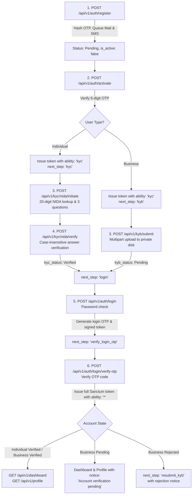

# Airlipa Secure Production REST API

A production-grade, secure REST API developed in **Laravel 11/12** and **PHP 8.2+** using **Laravel Sanctum** token authentication, clean architecture, 2-step OTP verification, NIDA mock identity verification (KYC), business verification (KYB), strict security headers, and automated test coverage.

---

## Architecture & Authentication Lifecycle



---

## Consistent Response Envelope

All API endpoints strictly output the consistent JSON envelope:

```json
{
  "success": true,
  "message": "Operation completed successfully.",
  "data": { ... },
  "errors": null,
  "next_step": "dashboard"
}
```

On validation or authorization errors:

```json
{
  "success": false,
  "message": "Validation failed.",
  "data": null,
  "errors": {
    "email": [
      "The email field must be a valid email address."
    ]
  },
  "next_step": null
}
```

---

## Security Implementation Highlights

1. **Encrypted NIDA with Blind Indexing**:
   - `nida_number` is stored encrypted using Laravel's native `'encrypted'` cast (AES-256-CBC).
   - A SHA-256 blind index hash (`nida_hash`) is indexed uniquely to prevent multiple users from linking the same NIDA number without decrypting all database rows.
2. **Timing-Safe Constant-Time Password Checks**:
   - Generic `"Invalid credentials"` returned for login failures to prevent user enumeration.
   - Fallback dummy bcrypt hash verification prevents side-channel timing leaks when an email does not exist.
3. **Lockout Controls**:
   - **Login**: Account locks for 15 minutes after 5 failed consecutive attempts (`locked_until`).
   - **KYC**: Account locks for 24 hours after 3 failed verification attempts in a 24-hour window. Only incorrect challenge answers count — abandoned (`Cancelled`) and elapsed (`Expired`) sessions do not, so retrying a challenge never consumes the lockout budget.
4. **2-Step Login OTP**:
   - Password authentication does not issue full tokens. It generates a 6-digit numeric OTP and a signed/encrypted 5-minute `otp_session_token`.
   - Full Sanctum tokens (`['*']`, 60-minute expiry) are only issued upon valid OTP verification.
5. **Private Storage & MIME Verification**:
   - Business KYB documents are stored on a private disk (`local`), never exposed to public storage.
   - Strict server-side MIME verification via `finfo` and rejection of double extensions (e.g., `document.php.pdf`).
   - Document downloads require temporary signed URLs (`URL::temporarySignedRoute`) or owner/admin authorization.
6. **Production Security Headers**:
   - `Strict-Transport-Security: max-age=31536000; includeSubDomains`
   - `X-Content-Type-Options: nosniff`
   - `X-Frame-Options: DENY`
   - `Referrer-Policy: strict-origin-when-cross-origin`
   - `Content-Security-Policy: default-src 'none'; frame-ancestors 'none'`
7. **Rate Limiting**:
   - Register: 5 requests / min / IP
   - Login: 5 requests / min / email + IP
   - OTP Verify: 5 requests / min
   - OTP Resend: 60s cooldown and max 3 resends / hour
   - Global API: 60 requests / min

---

## Environment Variables (`.env`)

Add or update the following values in your `.env` file:

```env
APP_NAME=Airlipa
APP_ENV=local
APP_KEY=base64:IBE53rK1ypAsKN20hcH0PdEQRdhlhhM+NKFSWAF692o=
APP_DEBUG=true
APP_URL=http://localhost:8000

# Database
DB_CONNECTION=mysql
DB_HOST=127.0.0.1
DB_PORT=3306
DB_DATABASE=airlipa
DB_USERNAME=root
DB_PASSWORD=

# Session & Cache
SESSION_DRIVER=database
CACHE_STORE=database
QUEUE_CONNECTION=database

# Email
MAIL_MAILER=log
MAIL_FROM_ADDRESS="no-reply@airlipa.com"
MAIL_FROM_NAME="${APP_NAME}"

# SMS Provider Configuration
SMS_DRIVER=log
SMS_URL=https://api.africastalking.com/version1/messaging
SMS_KEY=your_sms_api_key
SMS_SENDER=AIRLIPA

# Authentication & OTP Security Settings
AUTH_OTP_ACTIVATION_LENGTH=6
AUTH_OTP_ACTIVATION_EXPIRY_MINUTES=10
AUTH_OTP_ACTIVATION_MAX_ATTEMPTS=5
AUTH_OTP_ACTIVATION_COOLDOWN_SECONDS=60
AUTH_OTP_ACTIVATION_MAX_RESENDS_PER_HOUR=3

AUTH_OTP_LOGIN_LENGTH=6
AUTH_OTP_LOGIN_EXPIRY_MINUTES=5
AUTH_OTP_LOGIN_MAX_ATTEMPTS=5
AUTH_OTP_LOGIN_COOLDOWN_SECONDS=60
AUTH_OTP_LOGIN_MAX_RESENDS_PER_HOUR=3
AUTH_OTP_LOGIN_SESSION_MINUTES=5

AUTH_LOCKOUT_MAX_FAILED_LOGINS=5
AUTH_LOCKOUT_MINUTES=15

KYC_SESSION_EXPIRY_MINUTES=10
KYC_MAX_FAILED_ATTEMPTS=3
KYC_LOCKOUT_HOURS=24

SANCTUM_KYC_TOKEN_EXPIRY_MINUTES=60
SANCTUM_FULL_TOKEN_EXPIRY_MINUTES=60
```

---

## Setup & Installation

1. **Clone & Install Dependencies**:
   ```bash
   composer install
   ```

2. **Generate Key & Configure Storage**:
   ```bash
   php artisan key:generate
   ```

3. **Run Migrations & Seed Mock NIDA Records**:
   ```bash
   php artisan migrate:fresh --seed
   ```

4. **Start Application Server & Queue Listener**:
   ```bash
   php artisan serve
   php artisan queue:listen
   ```

---

## Seeded Admin Account

- **Email**: `admin@airlipa.com`
- **Password**: `AdminSecure#2026!`
- **Role**: `admin` (Authorized for `PATCH /api/v1/admin/kyb/{id}/approve` and `reject`)

---

## 20 Mock NIDA Records (Test Numbers & Answers)

All 20 records are automatically seeded via `php artisan db:seed` (`NidaMockSeeder`):

| # | NIDA Number | Name | Date of Birth | Mother's Name | Place of Birth | Region | District |
|---|-------------|------|---------------|---------------|----------------|--------|----------|
| 1 | `19900101123450000001` | Juma Hamisi | 1990-01-01 | Fatuma | Dar es Salaam | Dar es Salaam | Ilala |
| 2 | `19920512123450000002` | Asha Bakari | 1992-05-12 | Mariam | Zanzibar | Mjini Magharibi | Mjini |
| 3 | `19881120123450000003` | Baraka Massawe | 1988-11-20 | Grace | Moshi | Kilimanjaro | Moshi Urban |
| 4 | `19950315123450000004` | Neema Mushi | 1995-03-15 | Joyce | Arusha | Arusha | Arusha City |
| 5 | `19850722123450000005` | Kelvin Shirima | 1985-07-22 | Agnes | Rombo | Kilimanjaro | Rombo |
| 6 | `19930908123450000006` | Rehema Kassim | 1993-09-08 | Zubeda | Tanga | Tanga | Tanga City |
| 7 | `19871204123450000007` | Emmanuel Makundi | 1987-12-04 | Esther | Mbeya | Mbeya | Mbeya City |
| 8 | `19940228123450000008` | Zuhura Salum | 1994-02-28 | Halima | Morogoro | Morogoro | Morogoro Urban |
| 9 | `19910617123450000009` | Godfrey Temu | 1991-06-17 | Anna | Hai | Kilimanjaro | Hai |
| 10 | `19961010123450000010` | Upendo Tarimo | 1996-10-10 | Rose | Moshi | Kilimanjaro | Moshi Rural |
| 11 | `19890405123450000011` | Dennis Kimaro | 1989-04-05 | Beatrice | Dodoma | Dodoma | Dodoma Urban |
| 12 | `19970819123450000012` | Farida Ally | 1997-08-19 | Amina | Tabora | Tabora | Tabora Urban |
| 13 | `19860325123450000013` | Innocent Mollel | 1986-03-25 | Sikitu | Monduli | Arusha | Monduli |
| 14 | `19981212123450000014` | Hadija Mwinyi | 1998-12-12 | Saida | Bagamoyo | Pwani | Bagamoyo |
| 15 | `19900930123450000015` | Geoffrey Lyimo | 1990-09-30 | Martha | Mwanza | Mwanza | Nyamagana |
| 16 | `19930707123450000016` | Zainab Rashid | 1993-07-07 | Khadija | Lindi | Lindi | Lindi Urban |
| 17 | `19841024123450000017` | Joseph Mwita | 1984-10-24 | Tabu | Musoma | Mara | Musoma Urban |
| 18 | `19950505123450000018` | Jackline Minja | 1995-05-05 | Flora | Iringa | Iringa | Iringa Urban |
| 19 | `19920118123450000019` | Rashid Athumani | 1992-01-18 | Mwanahamis | Kigoma | Kigoma | Kigoma Ujiji |
| 20 | `19960823123450000020` | Saumu Omari | 1996-08-23 | Bimkubwa | Mtwara | Mtwara | Mtwara Urban |

### The Account Name Must Match the NIDA Record

`POST /api/v1/kyc/nida/initiate` cross-checks the **authenticated user's** registered `first_name` / `last_name` against the NIDA record before issuing challenge questions. Entering a valid seeded NIDA number from an account registered under a different name is rejected with `422 Identity mismatch`.

To verify successfully, register the account with the same name as the NIDA number you intend to use — for example an account named `Juma` / `Hamisi` paired with `19900101123450000001`. Matching is deliberately loose: it is case-insensitive, tolerates a swapped first/last name, and accepts ≥80% similarity.

### Troubleshooting KYC Errors

The browser console only reports the status code; the reason is in the JSON response body (`message`, plus `errors` for validation failures).

| Status | `message` | Cause & fix |
|---|---|---|
| `422` | `Validation failed.` | `nida_number` must be a JSON **string** of exactly 20 digits — no spaces, dashes or leading `+`, and the key is snake_case (not `nidaNumber`). See the payload note below. |
| `422` | `Identity mismatch: The registered name does not match the NIDA record.` | The logged-in account's name does not match that NIDA record. Use a matching pair from the table above. |
| `422` | `This NIDA number is already registered and verified with another account.` | That NIDA number is already `Verified` against a different user. Pick another record or re-seed. |
| `404` | `NIDA record not found with the provided identification number.` | Well-formed but absent from `nida_mock_records`. Run `php artisan migrate:fresh --seed`. |
| `423` | `KYC verification is locked for 24 hours due to multiple failed attempts.` | 3 genuinely incorrect challenge attempts within 24h. Wait it out, or clear the rows while developing (see below). |
| `429` | `Too many requests. Please slow down and try again later.` | The KYC routes are limited to 5 requests per minute. |
| `400` | `NIDA KYC is designated for Individual accounts only.` | The token belongs to a Business account, which must use `POST /api/v1/kyb/submit`. |
| `401` | `Unauthenticated.` | Missing or expired token, or the token lacks the `kyc` ability. |

**Sending `nida_number` from JavaScript.** 20 digits exceeds `Number.MAX_SAFE_INTEGER` (16 digits), so never route the value through a JS number: `Number("19900101123450000001")` silently becomes `19900101123450000000`, which then fails with `404`. Use `<input type="text" inputmode="numeric">` and keep the value a string end to end.

```json
{ "nida_number": "19900101123450000001" }
```

**Clearing a KYC lockout while developing.**

```bash
php artisan tinker --execute="App\Models\KycVerification::where('user_id', YOUR_USER_ID)->delete();"
```

Only genuinely incorrect challenge answers count toward the lockout. Sessions superseded by a newer `initiate` call are recorded as `Cancelled`, and sessions whose 10-minute window elapsed are recorded as `Expired` — neither consumes the 3-attempt budget, so retrying or refreshing mid-flow will not lock an account out.

---

## Postman Collection

Import `postman_collection.json` located at the root of the project into Postman. It includes pre-configured environment variables and full examples for every endpoint.

---

## Running Automated Feature Tests

Execute the Pest test suite:

```bash
php artisan test
```

Or target specific feature suites:

```bash
php artisan test --filter=RegistrationTest
php artisan test --filter=ActivationTest
php artisan test --filter=LoginTest
php artisan test --filter=PasswordResetTest
php artisan test --filter=KycTest
php artisan test --filter=KybTest
php artisan test --filter=DashboardProfileTest
php artisan test --filter=SecurityTest
```
